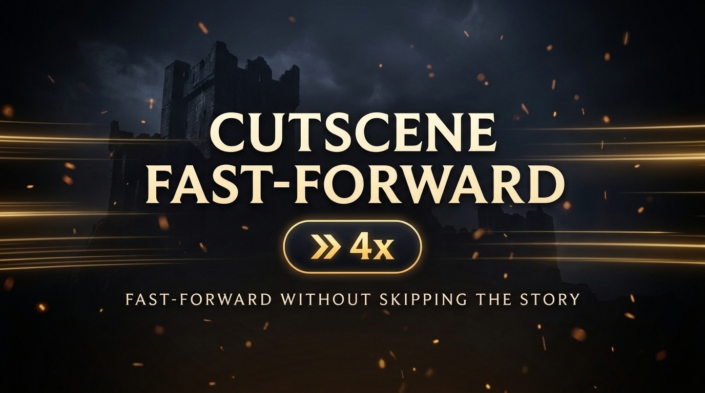
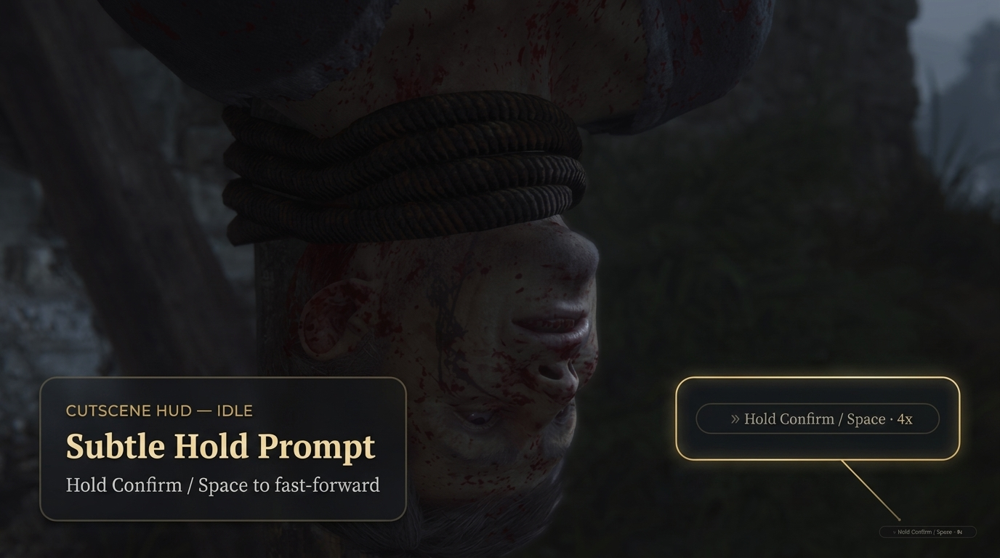
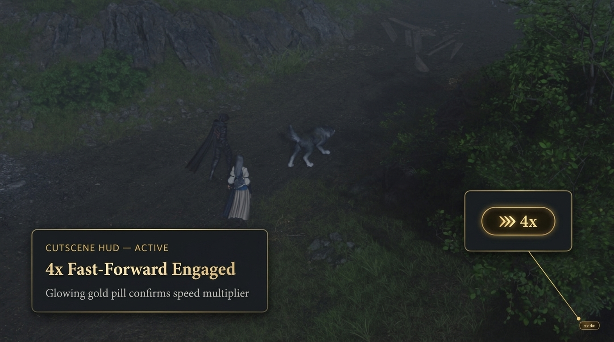

# Cutscene Fast-Forward for FINAL FANTASY XVI



A lightweight **Reloaded-II** quality-of-life mod for **FINAL FANTASY XVI (PC / Steam)** that lets you smoothly **fast-forward** slow in-engine cutscenes and pre-rendered `.bk2` movies by holding your standard Confirm button — so you can keep following the story and reading subtitles without skipping whole scenes.

---

## Why This Mod?

In vanilla FINAL FANTASY XVI:
- Regular NPC conversations can be tapped through line-by-line, but **full cutscenes** force you to either watch at 1x speed or skip the entire scene through the pause menu.
- **Cutscene Fast-Forward** gives you instant, on-demand fast-forward (`4x` by default, configurable up to `24x`) that activates **only during cutscenes and pre-rendered movies** and automatically returns to `1.0x` the moment you release the button, pause the game, or return to gameplay.

---

## Showcase

| Idle Cutscene Prompt | Active 4x Fast-Forward |
| :---: | :---: |
|  |  |

---

## Key Features

- **In-Engine Cutscene Fast-Forward (`1x` – `24x`, default `4x`):** Accelerates camera, character animation, subtitles, and timeline in lockstep across every shot of a cutscene — never affects normal gameplay, combat, or menus.
- **Pre-Rendered Movie (`.bk2`) Fast-Forward (`1x` – `8x`, default `4x`):** Works seamlessly on both standalone FMVs and `.bk2` movie segments embedded inside cutscenes, with built-in decode pacing so releasing the button stops instantly.
- **Universal Controls (Zero Setup):** Reads FFXVI's native Confirm action automatically:
  - **PlayStation (DualSense / DualShock):** Hold **Cross (`×`)**
  - **Xbox Controller:** Hold **A**
  - **Keyboard & Mouse:** Hold **Confirm** or **Space**
  - Also supports **Toggle** mode and custom extra keyboard / XInput bindings.
- **Clean, Auto-Hiding HUD Indicator:** Briefly shows a discreet corner hint when a cutscene begins (`» Hold Confirm / Space · 4x`), hides itself after 4 seconds for an uncluttered screen, and displays a minimal gold badge (`»» 4x`) while fast-forwarding. Scales cleanly at 1080p, 1440p, and 4K.
- **Pause & Alt-Tab Safe:** Automatically pauses and hides when opening the Cutscene Pause Menu, System Menu, or Active Time Lore, and continues working smoothly in Borderless Fullscreen with a controller even after Alt-Tabbing.
- **Zero DX12 Hooks / Maximum Compatibility:** Uses pure Win32 layered rendering for the indicator, making it 100% compatible with **FFXVIFix**, **DLSS / FSR Frame Generation**, **ReShade**, **Steam Overlay**, and other Reloaded-II mods.
- **Live Configuration (Hot-Reload):** Change speed, Hold/Toggle mode, controls, or HUD style in Reloaded-II while the game is running — no restart required.

---

## Installation Guide (Beginner Friendly)

Never installed a mod for FINAL FANTASY XVI before? Follow these steps:

### Step 1: Install Reloaded-II (Mod Manager)
1. Download **Reloaded-II** from the official website: [Reloaded-II Releases](https://github.com/Reloaded-Project/Reloaded-II/releases/latest) (download `Setup.exe` and run it, or extract `Release.zip` to a folder like `C:\Modding\Reloaded-II`).
2. Launch **Reloaded-II**.
3. Click the **`+` (Add Application)** button on the left sidebar and select your `ffxvi.exe` file:
   - Typical Steam path: `C:\Program Files (x86)\Steam\steamapps\common\FINAL FANTASY XVI\ffxvi.exe`
4. Click the **FINAL FANTASY XVI** icon that appears on the left sidebar.

### Step 2: Install Cutscene Fast-Forward
1. Download the latest **`FF16-Cutscene-Fast-Forward-v1.0.0.zip`** from the [Releases](https://github.com/mancer81/FF16-Cutscene-Fast-Forward/releases) page (or from Nexus Mods).
2. **Drag and drop the `.zip` file directly onto the Reloaded-II window.**
3. Reloaded-II will install the mod and automatically prompt you to download its two lightweight helper libraries (`reloaded.sharedlib.hooks` and `Reloaded.Memory.SigScan.ReloadedII`) — click **Yes / Download**.

> **Manual alternative:** Extract the `ff16.qol.cutscenefastforward` folder from the `.zip` into `Reloaded-II\Mods\`, then restart Reloaded-II and accept the dependency download prompt.

### Step 3: Enable & Play
1. Select **FINAL FANTASY XVI** in the left sidebar of Reloaded-II.
2. Open the **Manage Mods** tab and click the toggle next to **Cutscene Fast-Forward** (so it turns green/enabled), along with its required dependencies.
3. Click **Launch Application** in Reloaded-II to start the game with mods loaded.

---

## Controls & Usage

| Input Device | Default Fast-Forward Button |
| :--- | :--- |
| **DualSense / PlayStation** | Hold **Cross (`×`)** |
| **Xbox / XInput** | Hold **A** |
| **Keyboard & Mouse** | Hold **Space** or your in-game **Confirm** key |

- **Normal gameplay & regular skippable NPC dialogues are untouched** — you can still skip standard NPC lines with Cross/A/Confirm as usual.
- During a full cutscene or `.bk2` movie, hold the button to fast-forward and release at any moment to immediately return to `1.0x`.

---

## Configuration

Right-click **Cutscene Fast-Forward** in Reloaded-II and select **Configure Mod** (changes apply live in-game):

| Category | Option | Default | Description |
| :--- | :--- | :--- | :--- |
| **General** | Enabled | `true` | Master on/off switch. |
| **Fast-Forward** | Fast-Forward Speed | `4.0` | Speed multiplier for in-engine cutscenes (`1.0` – `24.0`). |
| **Fast-Forward** | Movie (.bk2) Fast-Forward Speed | `4.0` | Speed multiplier for pre-rendered `.bk2` movies (`1.0` – `8.0`). |
| **Fast-Forward** | Activation Mode | `Hold` | `Hold` while pressed, or `Toggle` on/off with one press. |
| **Controls** | Use Standard Confirm / Skip Button | `true` | Uses FFXVI's native Confirm action across all controllers & KBM. |
| **Controls** | Extra Keyboard Key | `Space` | Additional keyboard shortcut (`Space`, `Tab`, `E`, `F`, `LeftShift`, `RightControl`, `Period`, or `None`). |
| **Controls** | Extra XInput Gamepad Button | `None` | Optional additional XInput button (`RightTrigger`, `RightShoulder`, etc.). |
| **HUD** | Show On-Screen Indicator | `true` | Toggle the corner status pill on/off. |
| **HUD** | Auto-Hide Idle Hint (Seconds) | `4.0` | Hides the idle hint after N seconds (`0` = always show during cutscenes). |
| **HUD** | Indicator Position | `BottomRight` | `BottomRight`, `TopRight`, `BottomLeft`, or `TopLeft`. |
| **HUD** | Indicator Scale | `0.75` | Pill size multiplier (`0.40` – `1.50`). |
| **HUD** | Indicator Opacity | `0.78` | Idle transparency (`0.25` – `1.0`). |
| **Scene Scope** | Apply to In-Engine Cutscenes | `true` | Enable during full story/quest/level cutscenes. |
| **Scene Scope** | Apply to Pre-Rendered Movies (.bk2) | `true` | Enable during Bink2 `.bk2` movies and FMV segments. |
| **Scene Scope** | Apply to Simple NPC Dialogues | `false` | Optional fast-forward during normal NPC conversations. |
| **Scene Scope** | Apply to Experimental Side-Scenes | `false` | Optional non-standard scripted scene detection. |
| **Debug** | Debug Mode | `false` | Enables live timeline info in HUD and writes `debug.log` for bug reports. |

---

## Notes & FAQ

- **How does voice audio behave during Fast-Forward?**
  Dialogue plays at normal pitch (no chipmunk distortion) and cleanly transitions to the next line as the timeline catches up, while subtitles stay synced with the scene.
- **Why does a 4K `.bk2` movie cap around 3x–4x even if I set Movie Speed higher?**
  Bink2 decodes high-bitrate 4K video on the CPU. The mod uses automatic decode backpressure so fast-forward runs as fast as your CPU can smoothly decode while still stopping instantaneously the moment you release the button.
- **Game Version Compatibility:**
  Built and tested on **FINAL FANTASY XVI PC (Steam v1.03, no-Denuvo)** using signature scanning.
- **Having an issue?**
  Enable **Debug Mode** in *Configure Mod*, reproduce the issue, and attach `debug.log` from `Reloaded-II\User\Mods\ff16.qol.cutscenefastforward\` when opening a GitHub Issue.

---

## Building from Source

### Requirements
- [.NET 9.0 SDK](https://dotnet.microsoft.com/download/dotnet/9.0) (x64)
- Reloaded-II installed (optional, for direct deployment)

### Build & Deploy
```powershell
# Build only
powershell -ExecutionPolicy Bypass -File scripts\build-and-deploy.ps1 -BuildOnly

# Build and deploy to Reloaded-II (auto-uses $env:RELOADEDIIMODS or pass -ReloadedModsDir)
powershell -ExecutionPolicy Bypass -File scripts\build-and-deploy.ps1 -ReloadedModsDir "C:\Path\To\Reloaded-II\Mods"

# Build and create a Nexus Mods / Reloaded-II release zip in release/
powershell -ExecutionPolicy Bypass -File scripts\package-release.ps1
```

---

## License

Released under the [MIT License](LICENSE).

## Credits

- [Reloaded-II](https://github.com/Reloaded-Project/Reloaded-II), [Reloaded.Hooks](https://github.com/Reloaded-Project/Reloaded.Hooks), and [Reloaded.Memory.SigScan](https://github.com/Reloaded-Project/Reloaded.Memory.SigScan) by Sewer56 and contributors.
